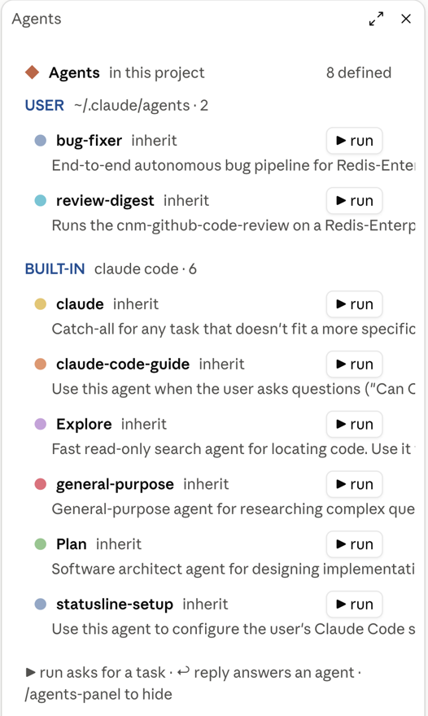
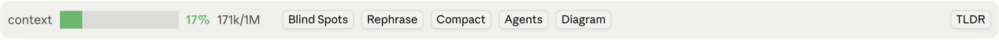

# agent-dock

An **Agents** side panel that lists every agent you can run, with controls to run, pause, reply, stop and open each one in its own tab. It also adds a context window bar with a **Compact** button above the prompt.



## How to use

- Press **Agents** above the prompt, or type `/agents-panel`, to show or hide the panel. While agents run, the button shows how many (`Agents · 2`).
- Agents are grouped by where they are defined: **PROJECT** (`.claude/agents`), **USER** (`~/.claude/agents`) and **BUILT-IN**.
- Each row shows the agent's one-line description, its model and its controls:
  - **▶ run** opens a field for the task, then starts the agent.
  - **‖** pauses a running agent. **↩ reply** sends it a follow-up.
  - **■** stops it. **⤢** opens its transcript in its own pane tab.
- The row keeps the agent's last answer after its turn ends.



## Context window bar

- The bar above the prompt shows how full the context window is. It is green, then orange from 25% and red from 50%.
- **Compact** compacts the conversation. In the desktop Code tab it runs `/compact` for you.

## How it works

- A run is a background subagent of the current session. Its tab is a pane that draws that subagent's transcript.
- When the main chat gets a notice about a run started from the panel, the mod adds a note so the main chat leaves it alone.

## Install

```
/plugin install agent-dock --marketplace korenka/claude-harness
```
