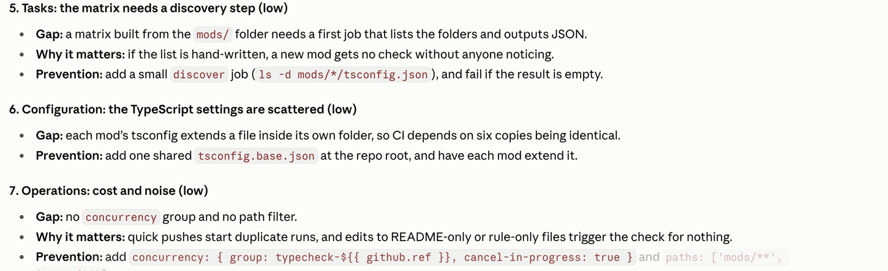

# blind-spots

Asks Claude to review the plan or design in the current conversation and list the engineering gaps it has not covered yet.



## How to use

- Press **Blind Spots** above the prompt, or type `/blind-spots`.
- Claude reviews the plan, design or task list discussed so far. It focuses on architecture first, then on the task breakdown.
- If there is no plan in the conversation yet, it says so in one sentence and stops.

## What it checks

Claude sweeps 20 topics and reports only the ones that apply and are not already covered:

| Area | Topics |
| --- | --- |
| Design | Trade-offs, design and OOP, API and data contracts, configuration |
| Performance | Time complexity, space complexity, throughput, rate limits, backpressure |
| Correctness | Concurrency, consistency and atomicity, idempotency and retries, failure modes |
| Delivery | Upgrade, rollout and rollback, testing, operations, tasks |
| Other | Security, observability, anything else a senior reviewer would raise |

For each gap, it gives:

- the gap, in one line
- why it matters for this design (a concrete failure, cost or scenario)
- how to prevent it during planning

Findings are grouped by topic, most severe first. Topics with nothing to report are listed on one line at the end.

## Install

```
/plugin install blind-spots --marketplace korenka/claude-harness
```
