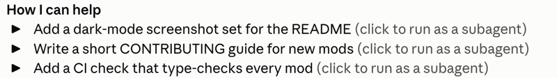

# help-offers

Turns the **How I can help** list at the end of Claude's answer into buttons. Each button starts a background subagent that does that task.



## How to use

1. Ask Claude for an answer that ends with a `How I can help` heading and a bullet list. The heading can also be the Hebrew `איך אני יכול לעזור`.
2. Each bullet shows as a button inside that message.
3. Click a button to start a subagent for that offer. The button shows its state:

| Mark | State |
| --- | --- |
| ▶ | Not started. Click to run it as a subagent. |
| … | The subagent is running. |
| ✓ | Done. Click to read the report. |
| ✗ | Stopped. Click to read what it returned. |

4. Clicking a finished offer fills the prompt with a request to walk you through its report.

## How it works

- The subagent can research, read code and draft changes in a feature branch.
- It is told not to send messages, push, open PRs, or create or edit tickets. Anything it would send goes into its report as a draft.
- When the subagent finishes, its report is saved as a Markdown file and a toast shows where it is.

## Configuration

The notes file and the report folder are set in `hooks/offers.ts` (`NOTES_FILE` and `REPORTS_DIR`). Change them to your own paths before you use the mod.

## Install

```
/plugin install help-offers --marketplace korenka/claude-harness
```
