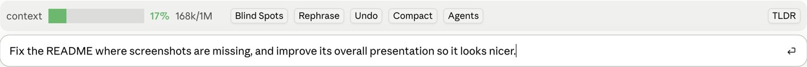

# rephrase

Rewrites the draft in your prompt box so Claude understands it on the first read. **Undo** brings your original back.



## How to use

1. Type your prompt as you normally would, but don't send it.
2. Press **Rephrase** above the prompt. The button shows `Rephrasing…` while it works.
3. The rewrite replaces your draft in the box. Edit it, send it, or press **Undo** to get the original back.

## How it works

- The draft goes to Haiku with strict rules:
  - Put the main ask first.
  - Add steps, bullets or numbering only where they help.
  - Keep your intent, language and point of view.
  - Keep every path, command, identifier, number, URL and ticket ID exactly as written.
- It never answers the prompt or adds new requirements. It only rewrites it.
- If the model returns nothing, the draft stays as it was and a toast tells you.

## Install

```
/plugin install rephrase --marketplace korenka/claude-harness
```
