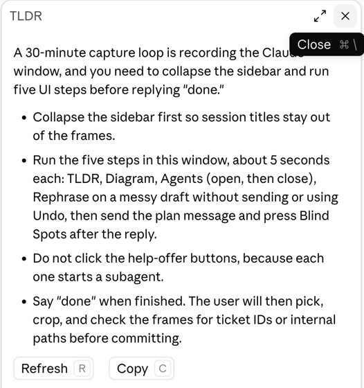

# tldr

Summarizes Claude's latest answer in a side pane, so you can read the bottom line without scrolling through a long reply.



## How to use

- Press **TLDR** above the prompt, or type `/tldr`.
- The pane opens with a one-line bottom line and up to four short bullets.
- **Refresh** (`r`) writes a new summary. **Copy** (`c`) copies it. `Esc` closes the pane.

## How it works

- It takes the assistant text of the most recent turn and sends it to Haiku with a short system prompt.
- The summary uses plain language and keeps real file, command and tool names. It never adds facts that are not in the answer.
- Nothing is saved to disk.

## Install

```
/plugin install tldr --marketplace korenka/claude-harness
```
